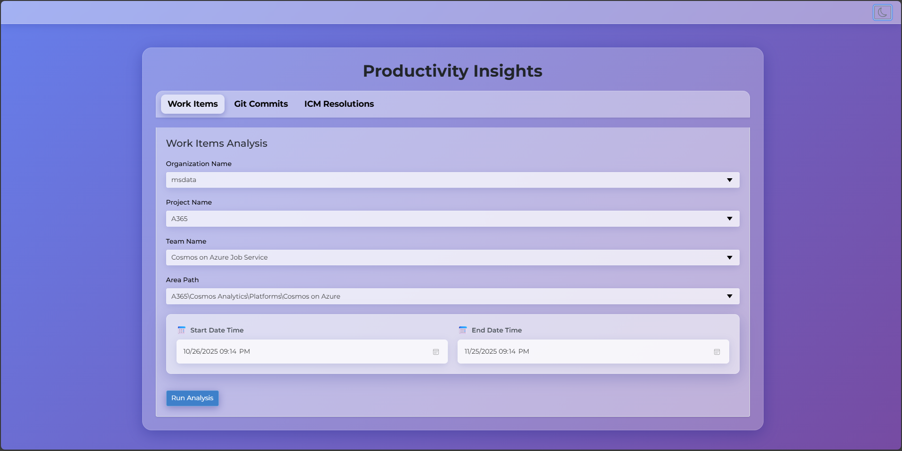
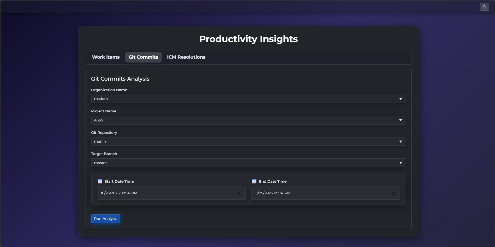

# Productivity Insights

A comprehensive Blazor-based web application for analyzing team productivity metrics from Azure DevOps and ICM (Incident Management). This tool provides detailed insights into work item completion, git commit activity, and incident resolution patterns.




## Features

### 📊 Work Items Analysis
- Track completed work items by team and assignee
- View work item completion statistics and trends
- Analyze time spent in active work states (Committed, Active, In Progress)
- Calculate time-to-complete metrics
- Detailed work item history with state transitions

### 🔄 Git Commits Analysis
- Track code contributions by author/committer
- View commit statistics with line-level changes (+additions/-deletions)
- Analyze per-file changes with detailed diff information
- Support for multiple repositories and branches
- Distinguish between added, edited, and deleted files

### 🚨 Incident Resolutions Analysis
- Query incident data from Azure Data Explorer
- Monitor incident resolution and mitigation metrics
- Track time-to-detect (TTD), time-to-mitigate (TTM), and time-to-resolve (TTR)
- Analyze incidents by severity and status
- View active and created incidents by owner
- Support Details, Trends, and Teams manager filtering
- View detailed active, mitigated, and resolved incident information

### Source Selection

**Work Items, Git Commits, and Incident Resolutions** use the same checkbox multi-select dropdown in **Details**, **Trends**, and **Teams**. Select individual entries, multiple entries across projects/repositories/owning teams, **Select All**, or clear the selection. Each view keeps its own choices: Details/Trends initially select the existing default source; Teams starts with Select All. Empty selections disable Run Analysis. Confirmation lists every selected source. Details/Trends collect all selected sources without a manager filter, deduplicate overlapping selections using source-qualified identities, and retain the captured sources for drill-downs and exports even after form edits or cache restoration. Incident Details/Trends query resolved, mitigated, active and created incidents for every selected owning team; unavailable categories fail the run explicitly rather than claiming zero activity. Git Trends combines all selected repositories; Work Items and Incident Trends retain their existing chart placeholders and export restrictions.

Selecting sources does not run analysis or bypass Teams manager selection and **Fetch Reports**. Feature Registry remains fixed to `msdata/A365/FeatureRegistry` across all target branches, with no source selection list.

### Feature Registry Analysis

The **Feature Registry** horizontal tab appears after Incident Resolutions in **Details**, **Trends**, and **Teams**. Its fixed source is `msdata/A365/FeatureRegistry`; it is not an option in Git Commits. Existing tabs, repository dropdowns, ordering, Details/Trends defaults, and ordinary report formats are unchanged.

- Lists all currently open PRs, including drafts, across **all target branches**, regardless of creation date.
- Lists completed PRs whose `closedDate` is within the selected **inclusive UTC wall-clock** range; abandoned PRs are excluded. **Start Date Time** and **End Date Time** use the same styling and populated initial values as Git Commits (local current time minus 30 days through local current time), with independent editable state. If cleared, dates fall back to 30 days before execution and execution time.
- **Analysis Parameters** uses the same styled heading, compact bordered table, bold labels, and date formatting as Git Commits, while confirming the PR-specific scope and Teams attribution.
- Shows linked PR ID/title, status/draft marker, author, source/target branches, creation time, and completion actor/time when applicable. No commits, line diffs, descriptions, reviews, comments, or trend charts are collected or displayed.
- Results use the same Contributor/Summary table, column widths, title styling, and expandable detail layout as Git Commits in all three views. Rows summarize open PRs by author and completed PRs by completion actor; expanding a row shows its captured PR fields without another API call, with a bold horizontal divider between the open and completed PR lists. Unattributed records remain separately accessible as **Membership unavailable**.
- **Teams** requires a selected manager and completed **Fetch Reports**. Open PRs are attributed to roster authors; completed PRs to their recorded `closedBy` actor. Unknown, ambiguous, or conflicting membership is disclosed separately, not guessed or credited as confirmed activity.
- Keeps its dates, result snapshots, and export contexts separate from Git Commits and the other analyses. Editing inputs does not relabel a completed result; rerun analysis to refresh it.
- **Confirm & Run** scrolls to the loading results after they render, matching the other analyses. Exporting or restoring cached results does not trigger another automatic scroll.

Collection uses a separate **read-only REST 7.1 collector** for repository metadata, paginated active/completed PR lists, and PR-detail fallback when needed. Teams also reads PR iterations and paginated iteration changes for each included or membership-unavailable PR; Details and Trends do not make these file-list queries. These are new Azure DevOps Git REST reads, using the existing authentication and repository read permissions. Existing commit APIs and collectors are unchanged. Both PR groups and, in Teams, their file lists must finish successfully before a snapshot is published; permission, malformed-response, pagination, cancellation, and resource-limit failures do not become partial or zero-success results. The collection interval is recorded because live paginated PR reads are not an atomic historical snapshot.

**Export Reports** saves the exact successful Run Analysis PR snapshot into both existing standalone HTML files, without further PR or token requests. Teams detailed HTML includes the captured roster hierarchy and offline links to matching PR evidence or explicit no-evidence destinations. Feature Registry exports use `Feature_Registry_<view>_<dates>_<runid>.zip`; the default extraction folder retains that ZIP stem, while both HTML filenames omit `<runid>`.

The **Teams summary HTML** matches the Git summary's dated heading, compact generated timestamp, dark theme, striped tables, spacing, and responsive styling. It shows per-member **Open PRs** and **Completed PRs** in by-repository and overall tables, ordered by completed PRs then open PRs. Every captured roster member appears, including zero-PR members; zero-activity repository cells use the Git reference's em-dash/empty placeholders. The collapsed **Captured inputs, sources and PR evidence** section retains every linked PR record, collection metadata, attribution notes, and the sibling detailed-report link. Membership-unavailable records stay outside roster totals and have a visible warning. Details/Trends summary layouts and ordinary Git reports are unchanged; no commit, line or file statistics are invented.

The detailed Feature Registry report follows the detailed Git report layout: dated title, section banners, per-person PR records with icon-led fields and full titles, and a repository summary table. The redundant overall PR summary is omitted. Teams individual headers show the person icon, name and PR counts without a **Contributor:** prefix. Teams **Pull Request:** headings show the full captured PR title instead of its number; the PR ID, title field and link remain in the details. Details/Trends and legacy Markdown retain their existing headers. In **Teams**, **Captured inputs and export query context** is the last section, after the repository summary and any navigation fallback sections. It starts collapsed with smaller, lighter text and includes the executed inputs, captured roster/sources, collection timestamps and snapshot notes; printing includes its full contents. Details/Trends continue to omit this section, and the separate summary HTML retains its existing metadata and notes. The report uses the same embedded font, dark-screen/light-print styling, and offline navigation. Teams person and PR sections fold independently and start collapsed; printing includes all their contents. Open PRs remain attributed to authors and completed PRs to completion actors, with membership-unavailable records separate. On-screen results are unchanged.

Teams detailed reports include every captured roster member in the main person list and repository summary. Members with no attributed PRs show **0 open PRs, 0 completed PRs** with name-only headings and summary rows, not email/principal/ID annotations. Reporting-hierarchy links target these same sections using captured identities, including when names are duplicated. Membership-unavailable PRs remain separate; zero counts describe attributed records, not proof of no activity.

In Teams detailed PR records, the actual full title appears directly after **Title:** on the same line, without a placeholder or separate code block. Long titles wrap naturally; recorded line breaks and safe encoding are preserved. A bold horizontal divider separates the Open PRs and Completed PRs lists for each person and in the membership-unavailable section, including empty lists, on screen and in print.

Each open or completed PR in the Teams detailed report includes its complete **Changed Files** list, with paths, change types and recorded original paths for renames. Lists use the latest iteration captured during analysis, [compared with its source/target common commit (`$compareTo=0`)](https://learn.microsoft.com/en-us/rest/api/azure/devops/git/pull-request-iteration-changes/get?view=azure-devops-rest-7.1), not just the last push. The captured iteration is displayed, folders are excluded, and identical file-change evidence is deduplicated within each PR. No file contents, line diffs, or commit enumeration are fetched. All files stay inside the PR's disclosure and print in full; online results and summary HTML stay unchanged. Empty comparisons are explicit; older snapshots without file lists show **unavailable** and require a new analysis, never an export-time requery.

Deleted-file entries may have a null current `item.path`; their recorded `originalPath` (or legacy `sourceServerItem`) supplies the deleted filename. Such files remain in the complete list. Entries with no usable recorded path still fail collection; an original path is never substituted for a missing add/edit/rename destination.

### Report Export
- **Export Reports** opens Save As and saves one ZIP for the displayed completed analysis to the folder you choose.
- In detailed reports, **Captured inputs and export query context** is a separate, initially collapsed section with smaller, lighter text. Click its heading or use Enter/Space to expand it offline. Printing includes its full contents even when collapsed; the top roster, summaries and record details remain independent. Teams + Git Commits, Teams + Work Items, Teams + Incident Resolutions and Teams + Feature Registry place this section last, after all totals, statistics, trends and any navigation fallback sections; Feature Registry Details/Trends omit it. Summary HTML is unchanged.
- Across all analyses and supported views, the ZIP retains its run GUID: `<stem>_<runid>.zip`. The two files inside omit the GUID: `<stem>.html` and `<stem>_Detailed.html`, where `<stem>` contains the analysis, view, and date range (for example, `Feature_Registry_teams_20260801_to_20260901`). Run identity remains in report metadata; extracting different runs into the same folder may prompt to overwrite their same-named HTML files.
- `<stem>_Detailed.html` replaces the Markdown file, retaining every contributor and detailed record, full work item state histories, every Git changed file, incident severity/time statistics, and supporting evidence. The same Markdown layout is rendered into readable headings, lists, tables and code blocks using Markdig, without re-collecting or changing the data.
- `<stem>.html` retains the existing dark, offline summary. Its layout and visible content are unchanged by filename shortening; its detail link points to the matching GUID-free `_Detailed.html` file. Both files are self-contained and require no scripts, screenshots or external assets. The button is labeled **Export Reports**; the ordinary summary link retains its legacy Markdown wording.

Detailed HTML uses the on-screen Montserrat typography and blue-accent, icon-led section styling in dark mode, with a light palette for printing. The variable font and its SIL Open Font License are embedded in the report, so no font download is needed when reading it offline. Generated console rulers become semantic headings and separators; recorded message text is left intact. Tables have tabular numerals and keyboard-accessible horizontal scrolling on narrow screens. Team Roster links jump to each member's first matching details (including shared author/committer sections and zero-commit headings). ICM paths link to their first source-qualified detail group. Both work offline and highlight/focus their destination; empty selections and members without collected details receive explicit destinations rather than broken links or invented activity. Identity/source keys, not display-name guesses, keep equal names and overlapping paths correctly linked. This detailed-only presentation/navigation layer does not change calculations, filenames, the summary HTML or the application UI.

In **Teams + Work Items**, **Teams + Git Commits**, and **Teams + Incident Resolutions** detailed HTML, each person's detail section can be folded independently by clicking its heading or focusing it and pressing Enter/Space. All person sections start collapsed. Shared Git author/committer groups stay together, and global summaries and source groups remain outside the personal folds. Incident roster links target the earlier individual heading or the member's overall summary row when no owned incidents exist; unavailable data has an explicit destination, not an invented zero-activity section. Native HTML controls work offline without scripts; current Edge/Chrome print all personal details even when folded on screen. Summary HTML and the online display are unchanged.

Individual work items and commits within those personal sections also have independent heading controls and start collapsed, including when their person is first expanded. Each work-item fold includes the complete fields, history and Recorded URL in its person's completion section; commit folds include the full message, changed files and Recorded URL. Closing and reopening a person preserves their item folds. Printing includes all nested content even if both levels are folded, without changing the screen's folding choices. Incident categories have the separate individual/category and category/contact folds described below; the later personal action-evidence sections are omitted.

Teams Work Items completion headings use **Work Item #ID - Title (Type)** so the title remains visible when the item is collapsed. The full title is repeated in the existing **Title:** field inside the item; online headings are unchanged.

Members with no completed work items use the same person-heading style, showing only **Name: 0 work item(s) completed**. They have no empty statistics, time-analysis blocks, or duplicate audit sections. Roster links point to these headings; members with work retain their full summaries, item details, and audit histories. Ambiguous names remain qualified consistently with other members.
- Details and Teams are supported for all analyses. Git Trends includes all period data and Feature Registry Trends exports its PR tables; the Work Item/Incident placeholder trend views cannot be exported.
- Existing analysis APIs, source selections, on-screen report formatting, icons, and Git's first-ten-files preview are unchanged. Export uses separate collectors and renderers.
- Renamed Git files use `originalPath` or legacy `sourceServerItem` when supplied. Split `delete, sourceRename` and destination entries are matched by their original blob identifiers across all pages. Both paths are retained, with line changes counted once at the destination; unresolved or ambiguous mappings block export instead of guessing.

## Technology Stack

- **Framework**: .NET 8.0
- **UI**: Blazor Server with Interactive Rendering
- **Styling**: Bootstrap 5
- **Authentication**: Azure Identity with Interactive Browser Credential
- **APIs**: 
  - Azure DevOps REST API (v7.0; v7.1 for Feature Registry PR reads)
  - Azure Data Explorer / Kusto

## Prerequisites

- .NET 8.0 SDK or later
- Azure DevOps account with appropriate permissions
- Access to the configured Azure Data Explorer incident warehouse
- Valid Azure AD credentials

## Installation

1. Clone the repository:
```bash
git clone <repository-url>
cd ProductivityInsights
```

2. Restore dependencies:
```bash
dotnet restore
```

3. Update configuration in `appsettings.json` if needed

4. Build the project:
```bash
dotnet build
```

## Running the Application

### Development Mode
```bash
dotnet run
```

The application will start on `https://localhost:<port>` (check console output for the exact URL).

### Production Mode
```bash
dotnet run --configuration Release
```

## Configuration

### Azure DevOps Settings
The application connects to Azure DevOps organizations and projects. Configure available options in `AnalysisOptions.razor`:

- **Organizations**: msdata, powerbi
- **Projects**: A365, HDInsight, MWC
- **Teams**: Cosmos on Azure Job Service, FastSpark, JS Reliability, etc.

### Incident Resolutions Settings
For incident analysis, configure:
- **Kusto Cluster**: Azure Data Explorer cluster URI in `appsettings.json`
- **Kusto Database**: Incident warehouse database in `appsettings.json`
- **Owning Teams**: Team paths in ICM

### Incident Report Coverage

**Teams + Incident Resolutions does not require `IncidentReportCoverage`.** It exports the currently available incident and in-period action records without extra schema/retention management queries or source-owner attestation. Missing, malformed, expired, or mismatched coverage configuration does not block Teams export. Both formats disclose that historical completeness is not independently verified; zero means no matching available records, not proof that the warehouse retains every historical action.

**Incident Details retains the stricter coverage prerequisite.** The export-only `IncidentReportCoverage` section is intentionally unconfigured. Add it only after obtaining an approved source contract for the configured cluster, database, silo (currently `"1"`), and owning teams. This unconfigured template does **not** enable Incident Details export:

```json
{
  "IncidentReportCoverage": {
    "ClusterUri": null,
    "Database": null,
    "SiloId": null,
    "Teams": [],
    "HistoryFrom": null,
    "HistoryThrough": null,
    "LatestIncidentsThrough": null,
    "PurgesThrough": null,
    "Evidence": null,
    "RetentionSemantics": null,
    "MinimumRetention": {
      "Incidents": null,
      "IncidentHistory": null,
      "PurgedIncidents": null,
      "PurgedIncidentHistory": null
    }
  }
}
```

`HistoryFrom`/`HistoryThrough` must establish the retention-safe `IncidentHistory.ChangeDate` window. `LatestIncidentsThrough` and `PurgesThrough` are applicability limits for the retained views and must cover the report's as-of instant. `Evidence` and `RetentionSemantics` must identify the source-owner contract, retention clock/policy history, and incident/history purge semantics. Do not substitute the current time, a maximum timestamp, earliest observed row, or assumed rolling window for missing evidence.

Use explicit-offset timestamps and positive .NET constant-format `TimeSpan` values for the four minimum retentions. The provider compares the source/silo/teams, bounds, applicability, schemas, and live retention policies with that contract. Configuration validation checks consistency; it does not authenticate or independently prove the truth of the attestation. Coverage concerns retained, published warehouse records, not a guarantee that every upstream action has already ingested.

ICM transports are resolved lazily for Incident exports; coverage configuration is read only when attestation is requested by Incident Details. Missing, expired, or inconsistent evidence blocks Details export without affecting Teams export, application startup, or ordinary analysis. Teams still requires successful data queries, including incident history and purge data: query/permission errors, partial responses, malformed required data, cancellation, and resource limits are not converted into zero activity.

While generating a Teams Incident Resolutions export, the online feedback identifies the full captured ICM queue and its position among distinct queues, for example **Collecting available ICM incidents (queue 1 of 3): AZURESYNAPSEJOBSERVICE\JobPlatform**. It switches to **Collecting recorded ICM actions** before the queue's history query. Overlapping selections of the same queue are counted once; source memberships, queries and exported data are unchanged.

The export-only history query broadcasts the small team-scoped incident key set into the date-filtered history join, rather than building a join hash table from warehouse-wide period history. Ordinary online analysis does not execute this history query. `E_RUNAWAY_QUERY` identifies a server-side operator memory limit, not ZIP size or missing coverage configuration. Export identifies the failing incident/history stage and reports known resource-limit codes without exposing raw server text. Keep incomplete-result safeguards enabled; optimize the query or reduce scope/date range if a genuine resource limit remains.

History IDs are qualified by silo and incident, not assumed globally unique. Teams export preserves in-scope actions whose warehouse `HistoryId` is null in the collected snapshot and contribution calculations, and both files disclose the missing-ID policy. The Teams detailed layout omits action-history tables. No history ID is invented. Identical unkeyed records are deduplicated using the recorded silo/incident, full actor identity, timestamp and action type; differences in any of those fields remain separate evidence. Contributed still counts distinct incident/member pairs, not action rows. Known-ID conflicts, missing columns, malformed non-null IDs, required incident/actor/time/type data, and the existing purge exclusions remain checked. Missing IDs do not establish independently verified history-purge completeness. Incident Details retains its stricter identity and coverage requirements.

### Authentication
The application uses Azure Interactive Browser Credential for authentication. On first run:
1. A browser window will open for Azure AD sign-in
2. Sign in with your Microsoft credentials
3. Grant necessary permissions for Azure DevOps and Azure Data Explorer access

## Usage

In **Teams**, Work Items, Git Commits, Incident Resolutions, and Feature Registry show a warning until a manager is selected and **Fetch Reports** finishes successfully. The warning names the selected analysis, clears when the roster is ready, and is not shown in Details or Trends.

### Analyzing Work Items
1. Navigate to the **Work Items** tab
2. Select organization, project, and team
3. Choose the area path
4. Set start and end date range
5. Click **Run Analysis**
6. View summary statistics and expand rows for detailed information

### Analyzing Git Commits
1. Navigate to the **Git Commits** tab
2. Select organization, project, and repository
3. Choose target branch (main/master)
4. Set date range
5. Click **Run Analysis**
6. View commit statistics with line changes per contributor
7. Expand rows to see individual commits with file-level details

### Analyzing Incident Resolutions
1. Navigate to the **Incident Resolutions** tab
2. Select an owning team
3. Set the date range
4. Click **Run Analysis**
5. View active, created, mitigated, and resolved incident metrics, including TTD, TTM, and TTR
6. Expand rows for detailed incident information

### Exporting Reports
1. Complete a supported analysis, then choose **Export Reports**.
2. In the native **Save As** dialog, choose a folder and ZIP filename, then select **Save**.
3. Keep the analysis open while the export-only collectors retrieve report records and save the ZIP to that destination. Feature Registry instead exports its successful Run Analysis snapshot without recollection.
4. Extract the ZIP from your chosen folder and open `<stem>.html` for the existing summary or `<stem>_Detailed.html` for the complete detailed report. No `.md` entry is included.

Destination selection requires a browser supporting `showSaveFilePicker`, such as desktop Microsoft Edge or Google Chrome, on HTTPS or localhost. Unsupported browsers or insecure remote HTTP show an explicit export error; there is no silent fallback to Downloads. The dialog opens directly from the click, before collection, and suggests the existing run-specific ZIP name. Changing that name does not change the matching detailed/summary HTML entry names. Cancelling the dialog does not collect report data.

The export module URL includes a SHA-256 fingerprint of the script supplied by the host's web-root file provider. This avoids reusing an older browser-cached module after an application update or circuit reconnect, including updates to JavaScript alone. If an already-open page reports that `bindExportButton` is undefined after upgrading from the unversioned loader, restart the updated app and reload that page once.

The browser commits the selected file only after a complete transfer and successful write; an earlier failure or cancellation aborts the write rather than replacing an existing file. Saving over an existing file follows the browser's overwrite confirmation. Selecting a new filename may leave an empty browser-created placeholder if export later fails; the application never deletes user files. Changing analyses or leaving the page invalidates the pending destination, although an already-open native dialog must still be dismissed manually. Cancellation cannot undo a file whose final commit has already started.

Git report downloads follow the reference Team Code Commit presentation. Detailed HTML renders the same icon-rich contributor/repository groups, chronological commit details, full changed-file lists, boxed separators, and signed summary tables as the former Markdown. Summary HTML opens with the unchanged compact generated timestamp and dark repository/overall tables, using the same icons and signed line counts. Zero-activity members appear once rather than once per repository; repository names and member labels stay qualified when needed to avoid ambiguity. Captured inputs, coverage, and supporting evidence remain available in the detailed appendix and the summary's expandable context section. Skipped-source warnings remain visible. Console progress logs, reporting-hierarchy levels, and parent SHAs are not fabricated when absent from the snapshot; no API or online-renderer changes are involved.

For **Teams + Git Commits**, the detailed HTML's TEAM ROSTER preserves the actual reporting hierarchy and sibling order captured from the loaded online tree, including collapsed branches. Member hyperlinks target their person headings, including shared author/committer sections and zero-commit headings. Later form edits or cache restores do not change the captured relationships; no additional directory queries are made. Older snapshots without hierarchy remain flat and disclose that the analysis must be rerun to capture it. Summary HTML is unchanged.

Teams Git detailed HTML uses one person list in captured roster/hierarchy order, interleaving active and zero-commit members rather than sorting zero members to the end. Older flat snapshots retain their captured roster order without inventing reporting relationships. All person headings use **Name: N commits** (including **Name: 0 commit** and **Name: 1 commit**) with the same person icon and no outer Contributor/Committer prefix or line totals. After a complete collection, zero-commit headings have no extra body details. Ambiguous names retain identity qualification. Shared author/committer groups keep both role labels and appear once at their first roster participant, after that person's direct-commit section when present; participants are not duplicated as zero-commit members. Commit groups without a roster match follow the roster. PR-only members retain their completed-PR counts; **0 commit** does not mean zero PRs. The redundant **Completed PR evidence** section and its standalone PR links are omitted from Teams Git detailed HTML only; distinct totals, trends and PR titles in commit headings remain. Details/Trends, legacy Markdown, summary HTML and PR collection/attribution are unchanged. When sources are skipped, unrepresented members stay in the same main list as **Name: 0 commit**, referring only to collected commits. A visible warning outside the folds and the per-person explanation distinguish missing source data from confirmed zero activity. These detail-only entries never create summary rows or enter totals; unavailable totals remain unavailable.

Teams Git detailed entries use **PR #123: Full PR title** for a valid first-line `Merged PR 123: Title` subject. A captured PR title from the same organization and repository takes precedence; otherwise the title is read from that recorded merge subject. This also covers shared author/committer groups whose PR completion is absent from the independently filtered snapshot. The fallback is display-only: it never creates a PR record, completion credit or an additional API call. Ordinary commits, malformed merge subjects and unavailable titles retain the **Commit: ID** heading; parent counts, incidental body mentions and contributor names never establish a match. The full commit ID, message and files remain inside the same collapsible entry. Titles are safely encoded and streamed from captured text references/slices without copying repeated titles into the structural Markdown buffer. Counts, attribution, source queries, summary HTML, Details/Trends and legacy Markdown are unchanged.

Both Teams + Git Commits HTML exports distinguish authors with 👤 and committers with ✍️, matching the on-screen display. Summary tables show icons and identity-qualified names without the `Author:` and `Committer:` labels; detailed summary tables, shared-group headings and individual commit fields retain those labels and their corresponding icons. Ordinary person headings use the unified name/count format. Icons do not change grouping, counts, or member navigation.

In the Teams + Git Commits detailed HTML, each commit's **Recorded URL** value is hyperlinked; the separate **URL** link is omitted. Missing or unsafe values retain the existing text/warning behavior. PR evidence links, summary HTML, and other views remain unchanged.

The same detailed report omits **Source-qualified key**, **Source memberships**, **Author identity**, and **Committer identity** only from each commit's footer. The author/committer entries at the top, remaining commit fields, captured input context, PR evidence, and source-qualified calculations are retained.

Its commit footers use 🔑 **Commit ID**, 🏢 **Organization**, 🗂️ **Repository ID**, 🗓️ **Author date**, and 📅 **Committer date**. The icons are detailed-Teams-Git-only decorations; recorded values and timestamp precision are unchanged.

Git summary HTML also includes **Files Added**, **Files Modified**, and **Files Deleted** for each repository/contributor row, overall contributor row, and trend period/total. These count file-change occurrences per commit, not unique paths or lines; empty and binary files are included even with zero line changes. Renames count once as modified at the destination, without separately counting a split-rename source entry as deleted. Other changes to existing entries, including encoding, properties and submodules, count as modified. Overall/trend totals deduplicate repository-qualified commits across overlapping source selections. The former Markdown's detailed content and on-screen report formats are unchanged.

**Teams + Work Items** exports follow the reference Team Work Item layout. Detailed HTML renders the captured roster, boxed person/team completion sections, chronological items with dated state transitions and their recorded actors, and icon-rich area/overall tables from the shared report snapshot. Summary HTML retains its compact generated timestamp and dark, automatically sized tables; its captured context is expandable below them. Area rows use each item's actual recorded area path, rather than the selected parent query path. Compact member, area and team labels stay qualified when ambiguous, and each zero-activity member has one placeholder row. Overlapping source selections retain their memberships without duplicating distinct items. The former **All contributor work item details** section is consolidated into **TEAM WORK ITEM COMPLETION DETAILS BY PERSON (Target State: Done)**: per-person summary tables and complete recorded fields, identities and histories live with their corresponding person and work item. Global totals and captured source context remain outside those folds. Console progress logs, server output paths and uncaptured hierarchy levels are not fabricated. Collection APIs, metric definitions and on-screen reports are unchanged.

The Teams + Work Items detailed HTML also shows the actual captured reporting hierarchy in **TEAM ROSTER**, retaining member hyperlinks and the online sibling order, including collapsed branches. Older flat snapshots require a new analysis to capture those relationships. Each member's completion section includes icon-led work-item entries matching the on-screen fields: title, state, priority, creation/closure or last-change dates, completion time, area/iteration, active-work time, state-change actors and durations, and a work-item link. Assignees retain identity qualification. Current-state durations end at the captured report as-of time, not the reader's current time; missing history remains unknown, not zero. Each item also retains its full recorded field evidence, precise history table and total time by state within the same fold. These additions reuse collected records without extra API calls and preserve summary HTML and legacy Markdown.

Each consolidated work item's **Recorded URL** value is hyperlinked once instead of displaying a separate **View Work Item** link. Missing or unsafe URLs retain their existing text/warning behavior. Summary HTML and non-Teams views are unchanged.

The redundant **Captured manager / report roster** subsection is omitted only from Teams + Work Items detailed HTML. The top **TEAM ROSTER** hierarchy and its member links remain, as do the captured manager field, selected sources and other query context. The summary report, other analysis types/views and legacy Markdown retain their existing roster sections.

**State Change History** actors in both the readable timeline and precise history table show names and email addresses without Principal or ID annotations. Full recorded identities remain available outside history; other views and legacy Markdown retain their existing identity format.

Each person with work items has the same summary tables previously shown in the separate audit section: total completed items, a **Work item type / Count** breakdown, and **Active-work measure (days) / Value** with total, minimum, average, maximum and median days, positive-duration item count and unavailable/single-revision count. These reuse deduplicated work items and the existing positive active-work durations; zero and unavailable durations do not enter the statistics. Zero-activity members show only **Name: 0 work item(s) completed**, without empty tables. Summary HTML, legacy Markdown, other views and online calculations are unchanged.

**Teams + Incident Resolutions** exports follow the incident references: detailed HTML renders boxed individual and ICM-path/category sections, compact `Incident Details` fields, and icon-rich source/overall tables. Its Team Roster preserves the actual manager/report hierarchy and sibling order captured from the online tree, including collapsed branches, with each member linked to their earlier individual section or overall summary row. Parent references are captured with the immutable roster, not inferred from names, indentation or current form values. Older snapshots without hierarchy retain a flat list and disclose that the analysis must be rerun to capture it. Summary HTML retains its compact dark layout, generated timestamp and expandable context, with a meaningful title rather than the reference's blank title. Members and their active source rows in summary tables are ordered by total metric activity, with one placeholder for each zero-activity member. The overall `TOTAL` sums contributor credits after source deduplication; Contributed totals are actor/incident pairs, not unique incidents across different actors. Category memberships may overlap without changing overall counts. Contributors come from the existing recorded in-period action evidence, not an added comments API. Full incident metadata and mitigation text appear once with each distinct incident's first ICM-path category occurrence; global duration statistics precede the final captured-input context section. Authentication/API progress logs and uncaptured hierarchy levels are not fabricated. Teams uses available warehouse data without the additional coverage prerequisite; data-query APIs, metric definitions and on-screen reports are unchanged.

**TEAM INCIDENT DETAILS BY INDIVIDUALS** precedes **TEAM INCIDENT DETAILS BY ICM PATH** in Teams detailed HTML. It combines all selected paths into one group per current owning contact, with initially collapsed Active, Created, Mitigated, Resolved and Contributed categories inside each collapsed contact group. Owner counts deduplicate silo-qualified incidents across paths and overlapping categories; category counts preserve the existing selection flags. Contributed retains the same residual category as the ICM-path view, but groups by owner here, not by contributor; recorded actors remain visible and their credit is unchanged. Aliases share a group, equal names stay identity-qualified, and missing owners or contributor evidence are not inferred. Empty categories remain explicit. Each compact record retains its title, clickable URL and owning-team path, with an offline **Full recorded evidence** link to the ICM-path record. Supplemental metadata and mitigation text remain once in the ICM-path section, rather than being duplicated in this additional view. Summary HTML, legacy Markdown, roster links, queries and online rendering are unchanged.

Individual headers show the person icon, qualified name and incident count without an **Owning Contact:** prefix. The ICM-path contact-group headers and incident fields retain their existing labels.

The **Active severity by owning team** and **Active TTD by owning team and severity** tables omit the generated **(silo ...)** suffix from their team captions in Teams detailed HTML. Both tables link each owning-team caption to the same corresponding ICM-path section in the offline report. Silo-qualified grouping is preserved: matching team names in different silos still have separate rows and destinations. Captured tenant/team text, counts, durations, other incident fields, legacy Markdown and summary HTML are unchanged.

The global **Active** section under **Incident statistics** omits **TTM by severity** and **TTR by severity** in Teams detailed HTML only. Severity counts, TTD and applicable owning-team tables remain. Individual summaries and overall weighted statistics still include all three duration measures; calculations, legacy Markdown, Incident Details, summary HTML and the online display are unchanged.

Each individual also has **Distinct closed incidents in group**, **Currently resolved**, **Currently mitigated**, **Severity counts**, and **TTD / TTM / TTR by severity** before their incident categories. These reuse the existing closed-incident contributor group and its duration statistics, matched by captured identity rather than display name. Closed-group attribution remains with the recorded resolver, or mitigator when no resolution timestamp exists; it is not changed to current ownership. Individuals without an attributed closed group have explicit zero counts and empty tables, not fabricated zero durations. The later personal statistics/evidence sections are omitted entirely. Contributors without an owning-contact section remain in the summary tables without a separate closed-statistics section. Global Active and overall statistics, contribution calculations and all other report formats remain unchanged.

In the Teams + Incident Resolutions detailed HTML, the **Active incidents**, **Created incidents**, **Mitigated incidents** and **Resolved incidents** categories under each captured ICM queue/source group start collapsed independently. Each category's records are grouped by **Owning Contact**, with each contact group also initially collapsed and showing its incident count. Grouping uses resolved captured identities: aliases share a group, equal display names remain identity-qualified, and unavailable owners stay explicit. Created incidents use the existing in-period Created flag and current owning contact, not the original creator or current Active status. Mitigated and Resolved incidents use their existing in-period flags and are displayed under their current owning contact; mitigation and resolution credits still belong to their respective recorded actors, not the owner. Existing source memberships, silo-qualified deduplication and incident order within each contact are preserved. Empty categories explicitly state that the collected queue has no incidents in that category. Category and contact headings support clicking and Enter/Space offline; reopening a category preserves its contact disclosure states, and printing includes all contents without changing screen state. Global Active statistics, contribution attribution and complete recorded evidence are retained without repeating full incident blocks later in the report.

The former **Other selected (including action-only)** category is now **Contributed Incidents** in Teams detailed HTML. It retains the same selected incidents outside Active, Created, Mitigated and Resolved, with a distinct silo-qualified incident count per queue. Within it, each **Contributor** group contains that person's incidents according to recorded in-period actions, not ownership. An incident appears once in each applicable contributor group; repeated actions and aliases do not duplicate it within a group. Equal display names stay identity-qualified, overlapping sources are deduplicated, and recorded actions without history IDs remain valid evidence. Incidents lacking contributor evidence stay in an explicit **No recorded in-period contributors** group without inventing attribution. The category and all its groups start collapsed, support offline click/keyboard controls and print in full. Repeated titles use captured text references for both headings and Title fields rather than inflating structural Markdown. Existing actor/incident contribution totals, recorded evidence, summary HTML, legacy Markdown and online rendering are unchanged.

Every compact incident block uses **Incident Details: Full title**, and its **URL** value is a direct hyperlink. The supplemental **Recorded URL** retained at the first ICM-path occurrence also links directly to the incident; the separate **View Incident** link is omitted. Titles are encoded and the headings stream references to captured text rather than copying repeated titles into structural Markdown. Unsafe URLs remain encoded text with an explicit warning; missing URLs remain explicit and unlinked. Summary HTML, legacy Markdown, other report views and the online display are unchanged.

**Incident statistics** contains the global Active statistics, followed directly by **Distinct incident totals and weighted duration statistics**. **Captured inputs and export query context** is the final section in Teams detailed HTML, after all statistics and any navigation fallback destinations; its contents, collapsed state and print behavior are unchanged. The personal sections formerly between **Active TTD by owning team and severity** and overall totals are removed, including their Created/Contributed detail buckets and recorded-action tables. They are not moved elsewhere or recreated as navigation fallbacks. The earlier **TEAM INCIDENT DETAILS BY INDIVIDUALS**, ICM-path categories, complete incident metadata and mitigation text remain. Roster destinations use captured identity: the earlier individual heading for an owner, their existing overall summary row otherwise, or an explicit unavailable-data destination when no source could be collected. Contribution attribution, null-history-ID handling, deduplication and all totals still use the same collected actions; only their detailed per-action presentation is omitted. The separate global **Recorded incident action history and contribution evidence** section also remains omitted. Legacy Markdown and non-Teams Incident Details retain their original context order, personal details and action-history section. No new API calls are made; cancellation, streaming limits, summary HTML and the online display are unchanged.

Export uses the inputs and manager roster captured for the executed run, not subsequently edited dropdowns. Both files use one immutable, source-qualified report snapshot with its run ID, effective query bounds, time zone, and as-of timestamp. Source data is collected for that saved selection at export time; repeat exports reuse a fully collected snapshot. Exports with skipped sources are not cached, so another export retries unavailable sources without changing the captured selection.

Filter metadata preserves the existing APIs' semantics: Work Items uses inclusive, date-only `StateChangeDate` filters; Git and ICM retain UTC-labeled wall-clock inputs without converting the host offset. Missing ICM start dates use the fixed UnixEpoch default. Other missing-date defaults are frozen at confirmation and explicitly identified; the unchanged analysis APIs evaluate time-dependent defaults independently.

**Metric definitions:** Git additions/deletions follow each diff block's change type; unchanged blocks never contribute, even when ADO reports different original/modified range lengths. PRs Merged counts distinct completed pull requests by the completion identity (`closedBy`) and completion time (`closedDate`), not the author or merge-commit count. Incident Contributed counts distinct incidents with recorded, in-period actions by each member. Incident Created retains the existing owning-contact attribution. Active is an as-of state, distinct from activity within the selected period. Teams summaries include the captured roster, including members with no matching activity in the collected data.

Git export follows the online flow's best-effort source availability behavior: a missing repository or branch, denied read, failed HTTP request, or transport failure skips that Git source and continues with other selections. Both downloaded formats list every skipped source and its error; original selections and roster remain visible. Source results are published atomically, so a late read failure cannot leave partially counted commits or PRs. Totals and zero-activity rows cover successfully collected sources only; an all-unavailable selection produces an explicitly unavailable report, not zero activity. Cancellation, resource limits, malformed required data, incomplete query responses, and unverifiable Incident Details history coverage remain errors rather than guessed data. Teams Incident export does not require independent historical coverage attestation. The existing analysis and contributor details remain usable. Changing the displayed analysis or leaving the page cancels the pending download.

**Incident Details export prerequisite:** A source-owner-supported earliest retained action time (or retention-clock mapping/policy history) and history-purge semantics are required for Details. A 740-day ingestion-retention policy alone does not prove coverage of an arbitrary `IncidentHistory.ChangeDate` window. Details export fails explicitly until valid coverage evidence is configured; Teams Incident export, ordinary incident analysis and Work Item/Git exports do not depend on that evidence. Synthetic incident fixtures verify the implementation, not production coverage.

Downloaded HTML now supports **256 MiB UTF-8 per file (512 MiB uncompressed for the pair)**. Writers stream directly into ZIP entries rather than allocating complete HTML strings. Detailed report preparation keeps recorded commit messages and mitigation texts separate from structural Markdown, parsing each distinct text once while retaining every full occurrence in the final report. This prevents repeated Active/Created/Contributed sections from multiplying those text allocations. Structural Markdown has a separate 64 MiB bound; buffered string-returning writer helpers retain their 32 MiB safety limit and are not used to build downloads.

The ZIP is built in an exclusively opened, randomly named OS temporary file and becomes available to the browser only after both entries are complete. It is deleted when its stream closes after download, cancellation or failure; it is never served from `wwwroot` or kept as a persistent server report. Preparation still bounds input records (including nested history/files), summary rows, identities, and individual text values. ADO collection rejects individual responses over 16 MiB, before parsing unbounded data. Work Items exports allow 512 MiB of cumulative decoded response data per collection by default; configure a positive byte limit with `ReportExport:WorkItems:MaxCollectionBytes` in configuration or `ReportExport__WorkItems__MaxCollectionBytes` in the environment. The budget includes complete revision histories across every selected source, not just the final report content. It is validated lazily when Work Items export is requested, so an invalid setting does not affect online analysis or other export types. Git and Feature Registry retain their 128 MiB cumulative collection budgets. Edited/renamed Git files use the supported Git `fileDiffs` API's first-parent line counts, not the UI endpoint's full source/diff text; resolved rename paths and exact additions/deletions are preserved. Collection limits are separate from the unchanged rendered-file and ZIP size limits. Requests exceeding any bound fail explicitly, never by truncating records.

## Project Structure

```
ProductivityInsights/
├── Components/
│   ├── Layout/           # Layout components (MainLayout, NavMenu)
│   └── Pages/            # Razor pages (AnalysisOptions, Home, etc.)
├── Metrics/              # Business logic for metrics calculation
│   ├── GitCommitMetrics.cs
│   ├── IncidentManagementMetrics.cs
│   └── WorkItemCompletionMetrics.cs
├── Models/               # Data models and DTOs
│   ├── CommitCollection.cs
│   ├── IncidentCollection.cs
│   ├── WorkItemDetailsCollection.cs
│   └── ...
├── Options/              # Query options classes
│   ├── CommitQueryOptions.cs
│   ├── IncidentManagementKustoOptions.cs
│   └── WorkItemQueryOptions.cs
├── Services/             # Application services
│   └── ThemeService.cs
├── Utilities/            # Helper utilities
│   ├── FormatUtilities.cs
│   ├── PrintUtilities.cs
│   └── UserToken.cs
├── wwwroot/              # Static files (CSS, JS)
├── Program.cs            # Application entry point
└── appsettings.json      # Configuration
```

## Key Features Implementation

### Caching
Analysis results are cached per tab to improve performance when switching between tabs. Results are refreshed when running a new analysis.
Export context and validated snapshots are maintained separately; export-only collection never replaces the existing analysis cache or detail-loading APIs.

### Interactive UI
- Expandable rows for detailed information
- Loading indicators during API calls
- Modal confirmations for analysis parameters
- Responsive design with Bootstrap

### Error Handling
- Graceful handling of API failures
- Warning messages for missing data
- Debug logging in development mode

## API Integration

### Azure DevOps REST API
The application uses the following endpoints:
- Commits: `/git/repositories/{repo}/commits`
- Commit Details: `/git/repositories/{repo}/commits/{id}`
- Commit Changes: `/git/repositories/{repo}/commits/{id}/changes`
- Work Items: `/wit/wiql` and `/wit/workitems`
- File Diffs: `/_versioncontrol/fileDiff`
- Feature Registry only: `/git/repositories/FeatureRegistry`, `/git/repositories/{id}/pullrequests`, and `/git/repositories/{id}/pullrequests/{prId}` (REST 7.1, GET only). Teams additionally uses `/pullrequests/{prId}/iterations?includeCommits=false` and `/pullrequests/{prId}/iterations/{iterationId}/changes?$compareTo=0` with complete pagination.

### Azure Data Explorer
- Queries active, created, mitigated, and resolved incidents from `IcmDataWarehouse`
- Uses `DefaultAzureCredential` and configured Kusto cluster/database settings

## Performance Considerations

- **Pagination**: Handles large datasets with continuation tokens
- **Rate Limiting**: Includes delays between API calls to avoid throttling
- **Async Operations**: All API calls are asynchronous
- **Parallel Processing**: Results are loaded in background tasks

## Troubleshooting

### Authentication Issues
- Ensure you have appropriate permissions in Azure DevOps
- Check Azure AD credentials and consent
- Verify Azure Data Explorer access for Incident Resolutions analysis

### API Errors
- Check network connectivity
- Verify organization/project names are correct
- Ensure date ranges are valid
- Review console output for detailed error messages

### Performance Issues
- Reduce date range for faster results
- Check for rate limiting errors in console
- Consider analyzing smaller teams/repositories

## Development

Run focused report and compatibility fixtures separately from the web project:

```powershell
dotnet run --project Tests\ProductivityInsights.ReportTests.csproj
```

The compatibility fixtures compare existing API/DTO/auth files, analysis paths, renderers, and report CSS against the restored `1379858` baseline. They permit the export control, export-context hooks, removal of PDF-only code, and narrowly scoped dedicated Feature Registry tab/dispatch/lifecycle additions. Existing Git dropdowns and collector implementations remain protected. Rebaseline these checks only for an explicitly approved change to existing analysis behavior.

Browser fixtures use synthetic data over a real Blazor circuit, not live external services. They exercise ZIP streaming, full content, unchanged displayed reports, failures, cancellation, and a 5,000-commit export. Git, Teams Work Items and Teams Incident fixtures also open the exported HTML and verify its rendered reference layout, columns, counts and collapsed context. `incident-available-export` and `incident-unkeyed-export` use production export registrations and the real Incident collector with a synthetic data-query client, absent coverage configuration, and denied metadata access. The unkeyed scenario requires an in-scope null-`HistoryId` action to contribute and appear as **Not provided** in the downloaded history. With Chrome or Edge installed:

```powershell
dotnet run --project Tests\ProductivityInsights.ReportTests.csproj -- --web --fixture gitCommits --urls http://127.0.0.1:5187
node Tests\reportBrowserTests.mjs http://127.0.0.1:5187/ gitCommits
```

Other fixture names are `workItems`, `incidentManagement`, `incident-active-groups`, `incident-available-export`, `incident-unkeyed-export`, `large`, `failed-export`, `slow-export`, `skipped-export`, `picker-stale`, and `stale-module`. The `incident-active-groups` scenario covers all five incident categories across two queues, nested contact/contributor disclosures, repeated incidents across contributors, alias resolution, owners distinct from recorded actors, missing action history IDs, same-number incidents in different silos, complete titled headers, clickable URLs, keyboard controls and printing of closed contents. The skipped-source scenario verifies that cancelled/unsupported pickers do not collect data, then checks a successful warning-only save, recovery retry, and complete-snapshot caching. The Git scenario also exercises disk-write failure and retry; `picker-stale` invalidates a destination while its dialog is pending. `stale-module` preloads a cached legacy export module without `bindExportButton` and verifies that the content-fingerprinted import still saves the ZIP. Set `REPORT_TEST_BROWSER` if the browser executable is outside its standard Windows installation directory.
Run all browser scenarios with `.\Tests\Run-ReportBrowserTests.ps1`; the script starts and stops only its own fixture hosts. Headless tests use trusted browser clicks and a picker/writer shim, not an automated native OS dialog. The shim preserves the real Blazor stream and captures ZIP bytes in the isolated test profile only on a simulated commit. Run `node Tests\reportDownloadTests.mjs` for focused picker, transactional-write, cancellation, error, and lifecycle checks.

Feature Registry scenarios are `feature-details`, `feature-trends`, `feature-teams`, `feature-empty`, `feature-failed`, `feature-files-failed`, `feature-slow`, and `feature-late`. They use the production PR collector with synthetic HTTP, exercise the actual new tab, preserve the independent Git result/form/export cache, inspect both downloaded HTML files, and check confirmation cancellation, failed-run retry (including changed-file queries), empty-result caching, stale completion, and Fetch Reports gating. Teams scenarios check complete file lists and rename paths inside each open/completed PR, without recollection on export. No live FeatureRegistry permissions are exercised.

For a bounded, read-only live ADO check, the fixture runner also accepts `--live --analysis gitCommits --organization <org> --project <project> --scope <repository> --branch <branch> --latest`. This checks a two-minute window around the latest commit and builds the ZIP in memory, printing counts and any skipped-source errors. Replace `--latest` with `--commit <40-character-sha>` to reproduce a specific commit and require its presence in the collected report. Add `--additional-scope <repository> --additional-branch <branch>` to check a mixed available/unavailable selection in the same organization/project. Alternatively supply explicit `--start`/`--end` UTC timestamps spanning at most seven days; use `--analysis workItems` with an area path as `--scope` for Work Items. Live probes use existing credentials and do not persist source records or tokens.

For a bounded live Teams Incident ZIP check, use `dotnet run --project Tests\ProductivityInsights.ReportTests.csproj -- --live-incident --cluster <HTTPS-cluster> --database <database> --scope <owning-team> --member <recorded-alias-or-email> --start <UTC-start> --end <UTC-end>`. This uses production registrations, credentials, transport, collector and writers without coverage configuration. It permits one owning team, a single-member probe roster, and at most 31 days; it prints only counts and ZIP size, and never saves source records or the ZIP.

Replace `--member <recorded-alias-or-email>` with `--member-from-unkeyed-action` to reproduce the missing-ID case. The probe selects one recorded actor from an in-period null-`HistoryId` action without printing that identity, then requires the real export to retain unkeyed evidence and disclose unavailable IDs in both ZIP entries. It fails rather than claiming success if no affected action is found.

### Debug Mode
Debug mode provides additional logging:
```csharp
#if DEBUG
    Console.WriteLine("Debug information...");
#endif
```

### Adding New Metrics
1. Create a new metrics class in `Metrics/`
2. Add corresponding models in `Models/`
3. Update `AnalysisOptions.razor` with new UI tab
4. Implement rendering methods for results display

## Contributing

When contributing to this project:
1. Follow existing code structure and naming conventions
2. Include XML documentation for public methods
3. Test with multiple organizations and date ranges
4. Update README for new features

## License

[Specify your license here]

## Support

For issues or questions:
- Check console output for error details
- Review Azure DevOps API documentation
- Verify authentication and permissions

## Version History

- **Current**: Initial release with work items, git commits, and ICM analysis

---

**Note**: This application requires appropriate permissions and credentials for Azure DevOps and ICM access. Ensure you have the necessary access before running analyses.
